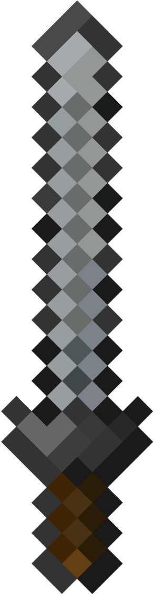
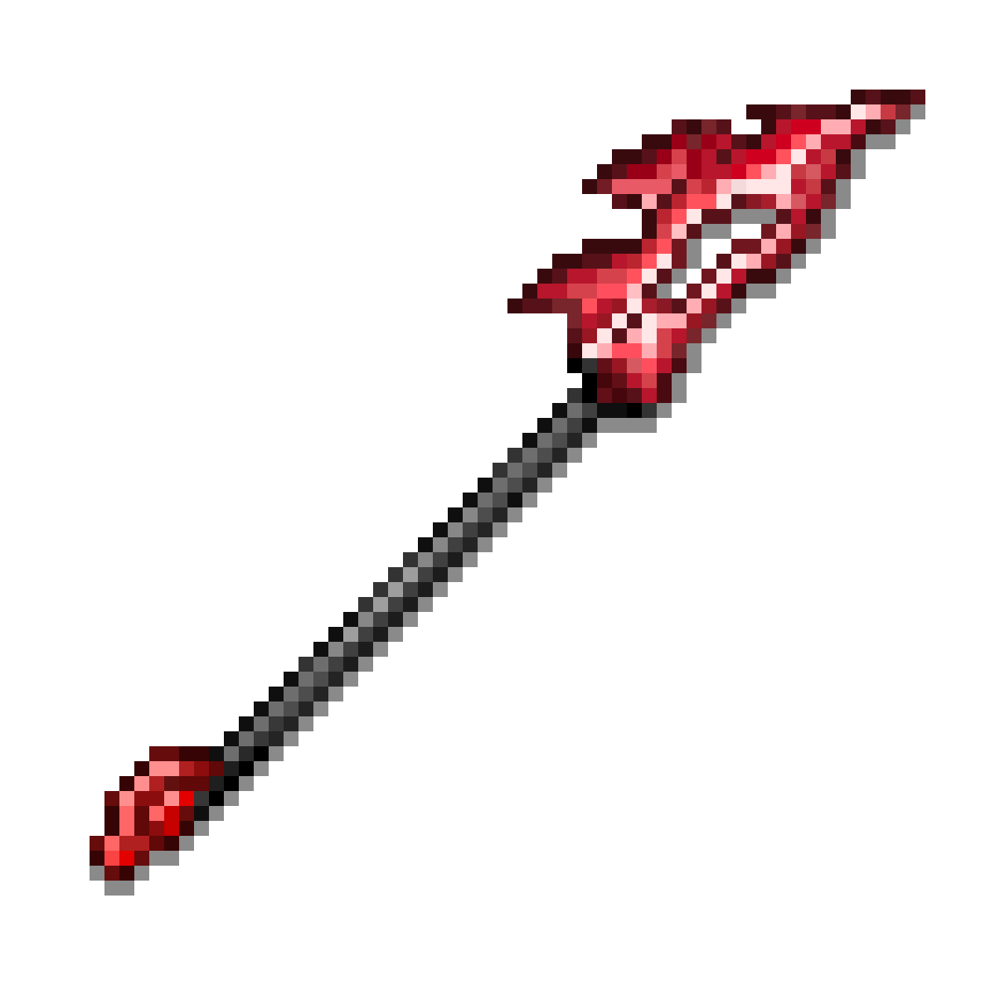
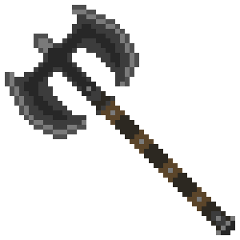
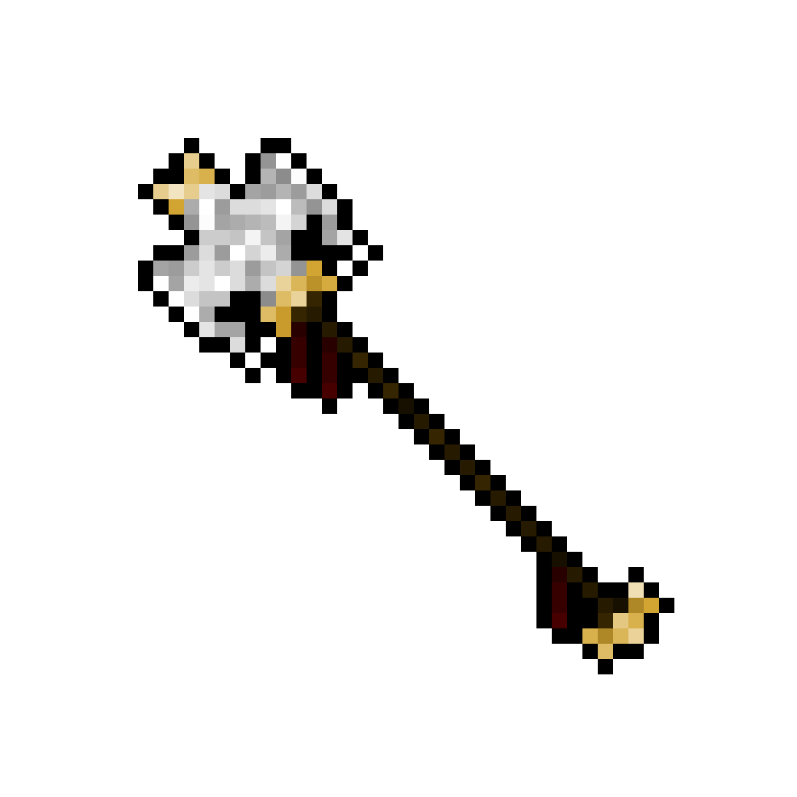
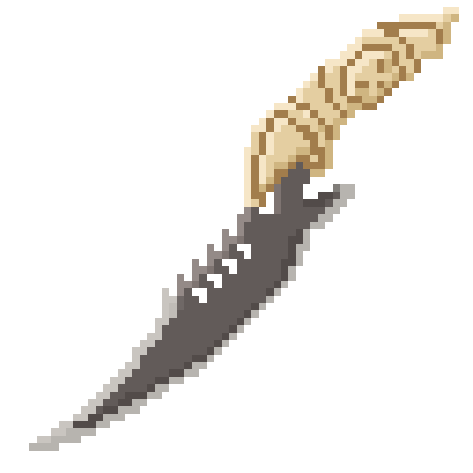
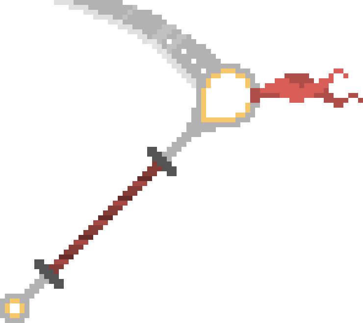

<div align="center">

# ⚔️ ARENA BATTLE

**A Zero-Engine 2D Physics & Weapon Combat Simulation built from scratch with Vanilla JavaScript (ES6+) and HTML5 Canvas.**

[](https://github.com/UsTa-afk/arena-game/releases/latest/download/Arena-Battle.apk)
[](https://usta-afk.github.io/arena-game/)
[](https://github.com/UsTa-afk/arena-game/actions)

</div>

---

## 📖 Overview

**Arena Battle** is a real-time 2D physics-based arena battler where two fighters clash autonomously using distinct weapon classes, state machines, status effects, and dynamic arena drops.

Built **without any external game engine**, all physics calculations, collision geometry, particle systems, and audio pipelines are implemented in modular Vanilla JavaScript and rendered on an HTML5 Canvas. The project is packaged as a native **Android APK** via **Capacitor** and automatically built/released through **GitHub Actions CI/CD**.

---

## 🛡️ Fighter Classes & Weapon Mechanics

| Icon | Weapon | Base Speed | Signature Ability & State Machine |
| :---: | :--- | :---: | :--- |
|  | **Sword** | `4.0` | **Relentless Edge:** Gains **+1 permanent damage** on every successful hit (stacks infinitely). |
|  | **Spear** | `6.0` | **Extending Reach:** Gains **+0.5 damage** and **+5 hitbox length** on every hit, out-ranging opponents over time. |
|  | **Axe** | `2.5` | **Executioner's Gamble:** Base damage is `1`, but starts with a **7.5% chance for 5× critical damage**. Every hit permanently increases crit chance by **+1%** and crit multiplier by **+2×**. |
|  | **Hammer** | `2.0` | **3-Phase State Machine:** Cycles between *Move (3.25s)* → *Charge (2.5s)* → *2× Giant Spin (1.33s)*. Direct spin hits deal **+2 permanent damage** and **Stun + Lock** the foe for **3s**. Weapon clashes during spin **Disarm** the foe for **3s**. |
|  | **Dagger** | `7.0` | **Shadow Copy & Recall:** Throws its blade at the opponent. On hit, copies the opponent's weapon & abilities for **8s with 2× damage & 2× spin speed**. If stuck in a wall for **7s**, telegraphs a dashed line and launches back toward the Dagger (hitting the foe on recall also triggers transformation!). |
|  | **Scythe** | `3.5` | **Reaper's Bleed:** Inflicts a **5s Bleed (DoT)** and **50% Slow (1s)** on hit. Each direct hit permanently increases Bleed DPS by **+0.1/s**. |

---

## 🎁 Dynamic Arena Drops & Pacing

| Icon | Mechanic | Description |
| :---: | :--- | :--- |
|  | **Mystery Chest Drop** | Every **8 seconds**, a Mystery Chest spawns at a random safe coordinate in the arena (max 1 active at a time). Collecting it grants a random **5-second buff**: <br>• 🔥 **`2X DMG`**: Doubles all outgoing weapon and projectile damage.<br>• ⚡ **`2X SPD`**: Boosts movement speed (`1.75×`) and weapon rotation speed (`1.6×`). |
| ⚡ | **Escalating Overdrive** | Every **10 seconds**, global movement speed scales up by **+15%** (capped at **`1.6×`** and clamped by a physics-safe ceiling `MAX_SAFE_SPEED` to prevent wall/ball tunneling). |

---

## 🧠 Engineering & Technical Highlights

* **2D Elastic Momentum Physics ([`js/combat.js`](js/combat.js)):** Ball-to-ball collisions resolve using 1D elastic collision equations along the normal vector, conserving momentum proportional to each fighter's radius/mass.
* **Separating Axis Theorem (SAT) & OBB-Circle Collision ([`js/combat.js`](js/combat.js)):**
  * *Weapon-vs-Weapon clashes* are computed by projecting the 4 world-space vertices of both rotated weapon bounding boxes onto their edge normals (SAT).
  * *Weapon-vs-Ball impacts* transform the defender's center into the attacker's local rotated coordinate space (OBB vs. Circle).
* **Low-Latency Web Audio Pipeline ([`js/audio.js`](js/audio.js)):** Pre-decodes weapon-specific `.mp3` buffers (`Sword_Hit`, `Spear_Hit`, `Axe_Hit`, `Axe_Crit_Hit`, `Hammer_Charge`, `Hammer_Hit`, `Scythe_Hit`, `Dagger_Transformation`, and `clash`) via the **Web Audio API** for zero-latency overlapping playback on mobile and desktop, with automatic touch-gesture unlocking and `<audio>` fallback.
* **Visual Polish ([`js/entities.js`](js/entities.js) & [`js/game.js`](js/game.js)):** Motion trails, particle bursts, floating damage/crit combat text, screen-shake feedback, and interpolated ("ghost") delayed health bars.
* **Automated Android APK CI/CD ([`.github/workflows/build-apk.yml`](.github/workflows/build-apk.yml)):** Every push automatically packages the web assets into a native Android project using **Capacitor** and compiles `Arena-Battle.apk` via Gradle on GitHub Actions, publishing it directly to **GitHub Releases**.

---

## 📂 Project Structure

```text
arena-game/
├── index.html                        # Clean semantic markup & mobile viewport config
├── css/
│   └── style.css                     # Neon UI theme, animations & responsive mobile layout
├── js/
│   ├── config.js                     # Arena constants, pacing settings & weapon stat table
│   ├── audio.js                      # Web Audio API sound manager + HTML5 Audio fallback
│   ├── entities.js                   # Particle, FloatingText, PowerUpOrb & Ball classes
│   ├── combat.js                     # Elastic physics, SAT / OBB collision & weapon effects
│   ├── game.js                       # Main animation loop, responsive canvas & HUD updates
│   └── ui.js                         # Weapon selection state & touch/keyboard listeners
├── assets/
│   ├── images/                       # Weapon sprites (sword, spear, axe, hammer, dagger, scythe) & chest.png
│   └── sounds/                       # Per-weapon impact SFX & clash audio
└── .github/workflows/
    └── build-apk.yml                 # Automated Android APK build & GitHub Release pipeline
```

---

## 🚀 Running Locally

No build step or bundler is required to run the web version:

1. Clone the repository:
   ```bash
   git clone https://github.com/UsTa-afk/arena-game.git
   cd arena-game
   ```
2. Open `index.html` directly in any browser, or serve it with a local static server:
   ```bash
   npx serve .
   ```

### 📲 Installing on Android
Grab the latest pre-built **`Arena-Battle.apk`** directly from [**GitHub Releases**](https://github.com/UsTa-afk/arena-game/releases/latest/download/Arena-Battle.apk) and install it on your Android phone.
